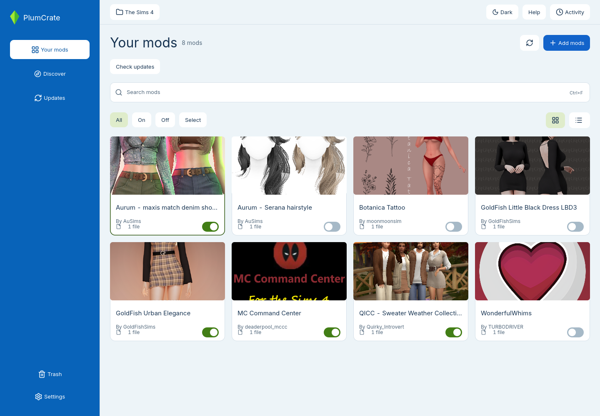
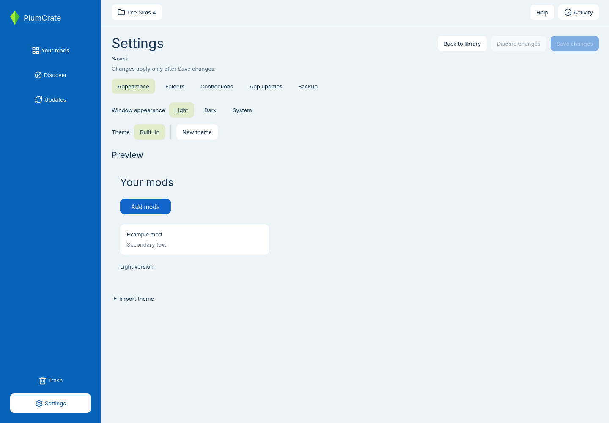

  

# PlumCrate

Your Sims 4 mods and custom content, organized on your Linux desktop.

Browse your collection by photo, find a file by name, and choose which mods are active in your game. Keep downloaded mods in a local library, with direct on/off switches and recoverable trash.

[Website](https://plumcrate.vercel.app/) · [Player guide](https://plumcrate.vercel.app/guide) · [Getting started](#getting-started) · [Documentation](docs/README.md) · [Report a bug](https://github.com/VitorCesarinoMarchese/PlumCrate/issues) · [Releases](https://github.com/VitorCesarinoMarchese/PlumCrate/releases)

*The current app with real mod covers in a demo library. [Cover credits and screenshot sources](docs/images/README.md).*

Dark mode

Settings and theme preview

## What you can do

| Feature | What you can do |
| --- | --- |
| Browse your collection | Switch between photo cards and a compact list. Search mod names and filenames, or filter installed and stored mods. |
| Search CurseForge | Browse Sims 4 mods and custom content by name, content type, category, game version, and sort order. Read author descriptions, inspect release dependencies, and view screenshots inside the app. Requires your API key in local Settings. |
| Install from CurseForge | Choose Download in browser to open the selected release’s download page, with inline source-saving and installation consent. The app verifies the completed download, imports it, and enables it automatically. |
| Bring your own mods | Import a local folder or ZIP archive, or review existing game mods before moving them into the managed library. |
| Choose what loads | Turn mods on or off directly from their cards or list rows. New imports start enabled. |
| Keep track of sources | Save a source link yourself, or review CurseForge suggestions and confirm a match. |
| Check for updates | Check attached CurseForge projects for newer public releases, then open the mod page to download manually. Record the release you installed before comparing versions. |
| Update the AppImage | Receive app update notices from GitHub, approve a verified download, and restart with the previous AppImage preserved. |
| Recover removed mods | Move managed mods to trash and review where they will go before restoring them. |
| Make it yours | Choose light, dark, or system appearance, create a custom theme, and remember your game folders. |

## First alpha

The first alpha, **v0.0.1-alpha.1**, is being prepared. Read the [release notes](docs/releases/v0.0.1-alpha.1.md) for features, download instructions, and limitations. Expect rough edges and report problems before relying on the app for your main collection.

Linux is the current supported platform. Windows and macOS have not been verified. Release downloads will appear on the [releases page](https://github.com/VitorCesarinoMarchese/PlumCrate/releases) when published. Until then, use the [build and run guide](docs/development.md#run-the-app).

The app manages local mods and checks attached CurseForge projects for newer releases on request. Update notices open the mod page for manual download; you replace your local files yourself. Browser-assisted installation opens the official release page and watches your Downloads folder after you approve the source and installation. The website may still require a Download or save click. CurseForge browsing, installation, lookup, and update checks need your own API key saved in local Settings. Suggestions and installed-release records are saved only after you confirm them, and weak source matches show a warning.

## Getting started

1. Open the app and choose your **The Sims 4** folder, the folder containing **Mods**. Use **Change folder** if the detected location is wrong.
2. Browse your existing mods, or open **Add mods** and select **Import folder** or **Import ZIP** to add files you have downloaded.
3. Use the switch on a mod card or list row to turn it on or off. New imports start enabled. Select the card to inspect its files.
4. Right-click a mod for more actions. Use **Restore from trash** to recover a removed managed mod.

To install a CurseForge mod, select your game, open **Discover**, and choose **Download in browser**. The inline note explains source saving and automatic installation; no extra popup appears. After you save the file in your browser, the app imports and enables the verified download without another click.

Read the project's **Description** and **Dependencies** before downloading. Required, optional, and tool dependencies offer their own **Download in browser** action. Each download needs a separate click; the app does not install a dependency chain automatically.

See the [app guide](docs/native-app.md) for [browser-assisted installation](docs/native-app.md#install-from-a-browser-download), settings, themes, source lookup, [update checks](docs/native-app.md#check-for-mod-updates), and folder selection.

## Your files stay yours

Your library and settings stay on your computer. Local browsing and mod management work without CurseForge. Optional CurseForge browsing, browser-assisted installation, source lookup, update checks, and remote preview images use network requests. AppImages also check GitHub releases for app updates; you can turn off automatic app checks in Settings. See [AppImage updates](docs/app-updates.md).

Imports, source changes, migration, trash, and restore keep their review steps. On/off switches apply directly. The app checks ownership before removing its links, leaves unmanaged files alone, and moves removed managed mods to recoverable trash. Read the [storage and safety details](docs/development.md#local-storage-and-safety) for locations and recovery behavior.

## Help and contribute

[Open an issue](https://github.com/VitorCesarinoMarchese/PlumCrate/issues) with what you expected, what happened, your Linux distribution, and steps to reproduce the problem. Screenshots help. Keep API keys and private file paths out of reports.

For code contributions, follow the [development and validation guide](docs/development.md). Architecture, safety contracts, packaging instructions, and past migration reports live in [docs](docs/README.md).

PlumCrate is an independent project and is not affiliated with Electronic Arts or Maxis.

Licensed under the [MIT License](LICENSE).
